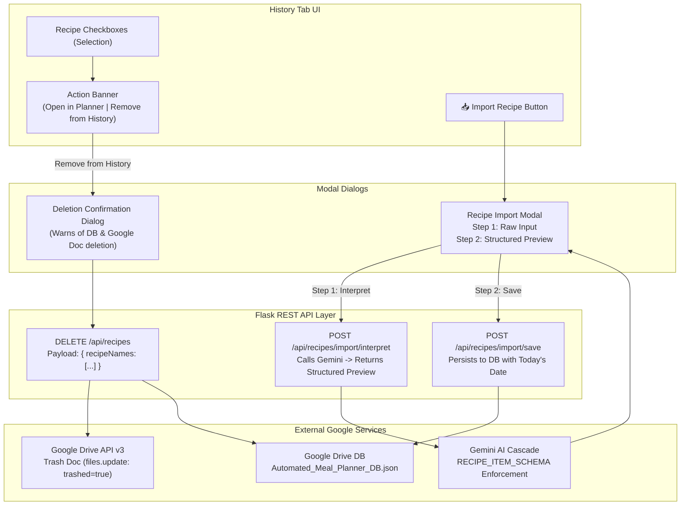

# Feature Specification: History Tab Recipe Deletion & AI-Powered Recipe Import

**Target System**: Meal Planning Assistant (Cloud Run / Flask & Vanilla JS SPA)  
**Document**: Technical Feature Specification & Architecture Plan  
**Date**: October 10, 2026  
**Status**: Ready for Final Review (User Decisions Incorporated)  

---

## 1. Overview & Objectives

This specification details the technical design, UI/UX workflow, data schema impact, Drive file management, and Gemini AI prompt engineering for two enhancements to the **History** tab:

1. **Recipe Deletion (Selection-Based Batch & Single)**: Allow users to remove recipes from their history using the existing checkboxes. Selection triggers an updated banner offering both **"Open in Planner"** and **"Remove from History"**. Deletion permanently removes records from `Automated_Meal_Planner_DB.json` and moves any associated Google Docs directly to Google Drive Trash.
2. **AI Recipe Import with Structured Preview**: An **"Import Recipe"** button on the History tab sub-navigation opens a modal where users provide a title and paste raw recipe text. Gemini AI interprets and parses the content into the standardized structured recipe format. A **Preview Step** displays the parsed ingredients, times, and instructions for user verification before persisting the recipe to the library with today's date.



---

## 2. Feature 1: Recipe Deletion from History

### 2.1 UI/UX Workflow & Banner Integration

1. **Checkbox Selection**:
   - Users select one or more recipes using the existing checkboxes next to each recipe on the History tab (`Recipe History` or `Family Favorites`).
   - Per design decision: **No per-item trash button** will be added to individual recipe rows; the checkboxes serve as the single, clean selection mechanism.
2. **Dual-Action Banner**:
   - The staged action banner (`#history-reuse-banner`) dynamically appears when 1 or more recipes are checked.
   - It contains both distinct action paths:
     - **Planner Re-use**: `[🗓️ Open in Planner]` (Gold button, stages recipes into the active planner).
     - **Deletion**: `[🗑️ Remove from History]` (Danger button with red styling).
     - **Dismiss**: `[✕ Clear]` (Unchecks all selections).
   - Banner text dynamically updates: `X recipes selected`.
3. **Safety Confirmation Dialog (`#modal-confirm-delete`)**:
   - Clicking `Remove from History` displays a modal dialog:
     > **Remove Selected Recipes?**  
     > You are about to permanently remove **{X} recipe(s)** from your history:  
     > - *Recipe 1*  
     > - *Recipe 2*  
     >   
     > This will delete them from your meal planner library and send any generated Google Docs for these recipes to your Google Drive Trash.  
     > `[Cancel]` `[🗑️ Permanently Delete]`

### 2.2 Backend & Storage Implementation

#### 1. Data Purge in `Automated_Meal_Planner_DB.json`
To prevent the schema migration in `services/storage_service.py` from auto-recreating deleted recipes from ratings:
- The backend removes the target recipe keys from **both** `db["recipeLibrary"]` AND `db["recipeRatings"]`.
- If the recipe was selected in client-side state (`appState.reusedRecipes`), it is cleared.

#### 2. Google Drive Trash Cleanup
- For each recipe being deleted, the backend checks if `docId` (or `fileId`) exists in `recipeLibrary[recipe_name]`.
- If a valid `docId` is present, the backend invokes Google Drive API v3 to trash the file:
  ```python
  drive.files().update(fileId=doc_id, body={"trashed": True}).execute()
  ```
- This ensures full cleanup with no orphaned Google Docs left in the user's Drive.

#### 3. API Contract
- **Route**: `DELETE /api/recipes`
- **Request Body**:
  ```json
  {
    "recipeNames": ["Creamy Tuscan Chicken", "Sheet Pan Fajitas"]
  }
  ```
- **Response**:
  ```json
  {
    "success": true,
    "deletedCount": 2,
    "trashedDocCount": 1,
    "db": { ... }
  }
  ```

---

## 3. Feature 2: AI-Powered Recipe Import (with Preview Step)

### 3.1 UI Placement

- On the History tab sub-navigation bar, alongside `[📜 Recipe History]` and `[⭐ Family Favorites]`, an **"📥 Import Recipe"** button is added:
  ```html
  <div class="history-subnav">
    <button id="subtab-history-recent" ...>📜 Recipe History</button>
    <button id="subtab-history-favorites" ...>⭐ Family Favorites</button>
    <button id="btn-import-recipe" class="history-action-btn" onclick="openImportRecipeModal()">
      <span>📥 Import Recipe</span>
    </button>
  </div>
  ```

### 3.2 Two-Phase Modal Architecture (`#modal-import-recipe`)

The modal operates in two sequential phases:

```
+-----------------------------------------------------------+
| 📥 Import Recipe                                       ✕  |
+-----------------------------------------------------------+
| [Step 1: Input]                | [Step 2: Preview & Save] |
|                                |                          |
| Recipe Title (Optional):       | Dish Name: [Editable]    |
| [ My Favorite Enchiladas     ] | Prep: [15m]  Cook: [30m] |
|                                |                          |
| Recipe Text / Notes:           | Ingredients Extracted:   |
| [ 2 lbs chicken breasts...   ] | - 2 lbs chicken breasts  |
| [ 1 cup salsa verde...       ] | - 1 cup salsa verde      |
| [ Bake at 375 for 25 mins... ] |                          |
|                                | Instructions:            |
| [x] ⭐ Add to Family Favorites | 1. Shred cooked chicken. |
|                                | 2. Roll in tortillas...  |
|                                |                          |
| [Cancel]   [✨ Interpret w/ AI]| [← Back]  [✓ Save Recipe]|
+-----------------------------------------------------------+
```

#### Phase 1: Input Screen
- **Recipe Title** (`input[type="text"]`): Optional title override. If omitted, Gemini generates an appetizing name from the text.
- **Recipe Text** (`textarea`): Multi-line paste area for ingredients, directions, notes, or website excerpts.
- **Star Favorite Checkbox**: `⭐ Mark as Family Favorite immediately` (default: unchecked).
- **Actions**:
  - `[Cancel]`
  - `[✨ Interpret Recipe with AI]` (Primary button; shows spinner and *"Analyzing recipe with Gemini..."* during request).

#### Phase 2: Structured Preview Screen
- Once Gemini responds, the modal switches to the preview view:
  - **Editable Name**: Title input pre-filled with Gemini's inferred or refined name.
  - **Editable Prep & Cook Times**: e.g., `Prep: 15 mins`, `Cook: 30 mins`.
  - **Structured Ingredients List**: Displayed in an easy-to-read list with amounts and units clearly separated.
  - **Sequential Instructions**: Formatted step-by-step instructions.
  - **Associated Date**: Shows today's date (`YYYY-MM-DD`).
- **Actions**:
  - `[← Back / Edit Text]`: Returns to Phase 1 preserving inputs if adjustments are needed.
  - `[✓ Confirm & Save to History]`: Finalizes persistence into the library.

### 3.3 Gemini AI Prompt & Schema

The backend endpoint `/api/recipes/import/interpret` passes the title and raw text to Gemini using `RECIPE_ITEM_SCHEMA`:

#### Structured Output Schema:
```json
{
  "name": "string",
  "description": "string",
  "prepTime": "string",
  "cookTime": "string",
  "ingredients": [
    {
      "name": "string",
      "amount": 1.5,
      "unit": "lbs"
    }
  ],
  "instructions": [
    "Step 1...",
    "Step 2..."
  ]
}
```

#### Prompt Directives:
```text
You are an expert culinary assistant. Parse and standardize the following raw recipe text into a structured JSON recipe.

USER TITLE OVERRIDE (if provided): {title}
RAW RECIPE TEXT:
{raw_text}

CRITICAL RULES:
1. If the user provided a title, prioritize it; otherwise invent a clear, appetizing recipe name.
2. Provide a 1-2 sentence description highlighting key flavors.
3. Realistic prepTime and cookTime must be provided (e.g., '15 mins', '30 mins').
4. Normalize all ingredients:
   - 'name': specific ingredient name
   - 'amount': numerical float/integer
   - 'unit': standard measurement ('cups', 'tbsp', 'tsp', 'oz', 'lbs', 'cloves', 'whole', etc.)
5. Format instructions into clear, ordered sequential steps.
```

### 3.4 Persistence Specification
Upon clicking **"Confirm & Save to History"**:
- **Date**: Assigned today's date formatted `YYYY-MM-DD` (`lastScheduledDate`).
- **Diners**: Assigned household diner count preference (`prefs.dinersCount`, default 4) as `originalDiners`.
- **Database Entry**:
  - Saved into `db["recipeLibrary"][recipe.name]`.
  - If favorited, also written to `db["recipeRatings"][recipe.name] = { isFavorite: true, rating: 5, favoritedAt: now }`.
- **UI Update**:
  - Recipe History list immediately re-rendered with the new recipe appearing at the top.
  - Subtab badge counts incremented.
  - Toast notification displayed: `✓ "${recipe.name}" saved to your Recipe History!`.
  - Modal automatically closed and reset.

---

## 4. Technical File Impact & Implementation Steps

| Component | File | Proposed Changes |
| :--- | :--- | :--- |
| **Drive Cleanup** | [services/drive_service.py](file:///c:/Users/philp/Documents/Google%20Cloud%20Project/Meal%20Planning/services/drive_service.py) | Add `trash_drive_file(file_id, credentials)` to move Google Docs to Drive Trash. |
| **Storage Helper** | [services/storage_service.py](file:///c:/Users/philp/Documents/Google%20Cloud%20Project/Meal%20Planning/services/storage_service.py) | Add `delete_recipes_from_db(db, recipe_names)` ensuring purge from both `recipeLibrary` and `recipeRatings`. |
| **Gemini Import** | [services/gemini_service.py](file:///c:/Users/philp/Documents/Google%20Cloud%20Project/Meal%20Planning/services/gemini_service.py) | Add `interpret_imported_recipe_ai(title, raw_text, api_key, key_type)`. |
| **API Endpoints** | [routes/api.py](file:///c:/Users/philp/Documents/Google%20Cloud%20Project/Meal%20Planning/routes/api.py) | - `DELETE /api/recipes` (DB purge + Drive Doc trash)<br/>- `POST /api/recipes/import/interpret` (Gemini parsing)<br/>- `POST /api/recipes/import/save` (Final DB save) |
| **API Client** | [static/js/api_client.js](file:///c:/Users/philp/Documents/Google%20Cloud%20Project/Meal%20Planning/static/js/api_client.js) | Add `deleteRecipes()`, `interpretImportedRecipe()`, `saveImportedRecipe()`, and GasRunShim shims. |
| **HTML Shell** | [templates/index.html](file:///c:/Users/philp/Documents/Google%20Cloud%20Project/Meal%20Planning/templates/index.html) | - Add `[📥 Import Recipe]` button in subnav.<br/>- Add `#modal-confirm-delete` dialog.<br/>- Add `#modal-import-recipe` 2-phase modal. |
| **Styling** | [static/css/styles.css](file:///c:/Users/philp/Documents/Google%20Cloud%20Project/Meal%20Planning/static/css/styles.css) | - Modal styling for import & preview.<br/>- Danger action button styling in reuse/history banner. |
| **Frontend Logic**| [static/js/app.js](file:///c:/Users/philp/Documents/Google%20Cloud%20Project/Meal%20Planning/static/js/app.js) | - Update `updateReuseBanners()` with `Remove from History` button.<br/>- Add confirmation modal handler.<br/>- Add 2-phase import flow handlers & rendering. |
| **Automated Tests**| [tests/test_api_routes.py](file:///c:/Users/philp/Documents/Google%20Cloud%20Project/Meal%20Planning/tests/test_api_routes.py) | Add tests for delete route, Drive trash invocation, and import endpoints. |

---

## 5. Summary of Incorporated Decisions

1. **Selection Banner**: Displays both `[🗓️ Open in Planner]` and `[🗑️ Remove from History]`.
2. **Per-Item Delete**: Excluded; selection checkboxes remain the unified interaction.
3. **Google Docs Trash**: Associated Google Docs (`docId`) are automatically trashed in Google Drive upon deletion.
4. **Import Review Step**: Two-phase modal includes a structured preview screen for reviewing extracted recipe elements before committing to storage.
